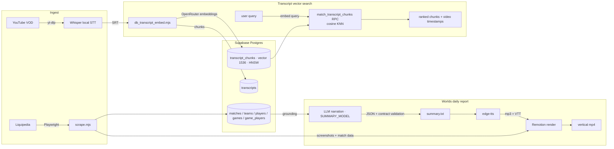

# leagueProTracker

**LoL esports → AI-narrated video + transcript vector search.** A three-pipeline toolkit that scrapes professional League of Legends match data, generates LLM-written Mandarin narration, renders it as a vertical Remotion video, and turns full-match commentary VODs into a pgvector-backed semantic search database.

## Demo

**Text-to-SQL semantic search over the transcript database** (retrieving match commentary info from Supabase):

https://raw.githubusercontent.com/jjkwiee1031/leagueProTracker/master/demo/demo1.mp4

**Rendered Worlds daily report video** (2026-11-15):

https://raw.githubusercontent.com/jjkwiee1031/leagueProTracker/master/demo/2026-11-15_worlds_report.mp4

## Overview

Following a professional LoL tournament day-by-day means re-reading Liquipedia match pages and writing the same recap over and over. This project automates that:

1. **Worlds daily report video** — scrape a day's matches → ingest into Supabase → LLM writes Mandarin narration → edge-tts synthesizes audio + subtitles → Remotion renders a vertical video.
   Entry point: `scripts/run_pipeline.sh <YYYY-MM-DD> "<tournament>"`.
2. **Full-VOD transcripts → RAG semantic search** — download a pro-match VOD's audio (yt-dlp) → transcribe locally with Whisper → chunk into time windows → embed with `text-embedding-3-small` into a pgvector database (HNSW cosine index, KNN RPC with metadata filters) → retrieval-augmented semantic search over the commentary, with results mapped back to video timestamps. The Supabase schema powering both pipelines lives in `leagueProDB/` (see `leagueProDB/DATABASE.md`).

The interesting AI engineering problem is the **narration↔video contract**: the LLM must return JSON whose line counts exactly match the video's match cards, and edge-tts emits exactly one subtitle cue per line — so the pipeline validates the LLM output against the contract and fails loudly instead of rendering a broken video. There is a deterministic `--template` fallback for offline reproduction.

## Key Features

- **Playwright scraper** for Liquipedia match-detail pages: per-game durations, winners, rosters, and player-performance screenshots; persistent browser profile to survive Cloudflare Turnstile (re-run with `--headed` to clear the CAPTCHA once).
- **Contract-validated LLM narration** — JSON schema checks (intro / one line per match / recap / outro), single-line texts, retry loop that feeds validation errors back to the model, no silent fallback.
- **Grounded summarization** — narration is generated from DB match data, so player names/teams/results come from the database rather than the model's memory.
- **pgvector semantic search** — SRT → ~45 s time-window chunks (≤1200 chars, timestamps preserved) → `text-embedding-3-small` embeddings → HNSW cosine index → RPC KNN query with optional team/date/game filters, results mapped back to video timestamps.
- **Idempotent DB ingestion** — `UNIQUE(game_id, chunk_index)` with replace-per-game; embedding batches are completed *before* old chunks are deleted, so a mid-batch API failure can't leave a game half-stored.
- **Automated video rendering** — Remotion composition zips TTS audio cues to subtitle cues 1:1 and renders match cards from scraped data.
- **Orchestrated pipeline runner** — staged bash runner with per-stage timing, logs, `--dry-run` / `--skip-*` / `--stop-after-db` flags.

## Architecture



- **Scraper** (Playwright, Node) writes `matches.json` + screenshots, ingests into Supabase via REST (PostgREST).
- **Narration** is generated by **GLM (`glm-5.3-flash`)** called headlessly (`pi --print`) and validated against the video contract before anything downstream runs.
- **TTS** (`edge-tts`) produces narration mp3 + VTT subtitles in one pass.
- **Remotion** renders the vertical video from the scraped data + TTS outputs; all colors centralized in `remotion/src/theme.ts`.
- **Transcripts** are chunked, embedded (OpenRouter → OpenAI-compatible embeddings endpoint), and searched through a Postgres RPC.

## Technology Stack

| Category | Used |
|---|---|
| Languages | JavaScript (Node 20, ESM), Bash, SQL, TypeScript (Remotion), Python (TTS glue) |
| AI / STT | OpenAI **Whisper** (local), **edge-tts** neural TTS |
| LLM integration | Headless LLM invocation (`pi --print` wrapper with retry + JSON extraction), **GLM `glm-5.3-flash`** via configurable `SUMMARY_MODEL` |
| Embeddings / RAG | OpenAI **`text-embedding-3-small`** (1536-dim) via **OpenRouter**, pgvector HNSW + cosine KNN RPC |
| Backend / DB | **Supabase** (Postgres, PostgREST, RLS, RPC), schema + versioned migrations |
| Scraping | **Playwright** (persistent profile, Cloudflare handling) |
| Video | **Remotion** (React-based programmatic rendering) |
| Media tooling | yt-dlp, ffmpeg/ffprobe |

## How It Works

**Worlds daily report** (`scripts/run_pipeline.sh <date> "<tournament>"`):
1. Playwright scrapes that day's Liquipedia matches → `matches.json`, per-game screenshots.
2. `db_ingest.mjs` upserts teams/players/matches/games into Supabase (idempotent per match-day).
3. `db_match_lookup.mjs` pulls match data back from the DB to ground the narration prompt.
4. `generate_summary.mjs` calls the LLM, validates the JSON against the narration contract (retries feed errors back), writes `summary.txt`. `--template` bypasses the LLM deterministically.
5. `tts.sh` runs edge-tts → `narration.mp3` + `narration.vtt`.
6. `parse_vtt.mjs` zips audio segments to subtitle cues 1:1; Remotion renders `WorldsReport` → `output/<date>_worlds_report.mp4`.

**Transcript vector search**:
1. yt-dlp downloads the VOD audio; local Whisper transcribes to SRT.
2. `db_transcript_upload.mjs` stores the full transcript per game.
3. `db_transcript_embed.mjs` chunks the SRT (~45 s windows, timestamps kept) and embeds each batch via OpenRouter; chunks replace per game atomically (embed-first-then-delete). `--dry-run` previews.
4. `db_semantic_search.mjs` embeds the query, calls the `match_transcript_chunks` RPC (cosine KNN + team/date/game filters), prints ranked commentary with video timestamps.

## Setup

```bash
# Node 20+
npm install            # repo root
cd remotion && npm install   # video project (own git history)

# leagueProDB/.env
SUPABASE_URL=...
SUPABASE_SECRET_KEY=...
EMBEDDING_API_KEY=...        # or OPENROUTER_API_KEY — for text-embedding-3-small

# On PATH: edge-tts, ffprobe, python3, yt-dlp (vendored under yt-dlp/, gitignored)
```

Database migrations (incl. pgvector) live in `leagueProDB/supabase/migrations/`.

Usage:

```bash
scripts/run_pipeline.sh 2026-11-08 "World Championship 2026" [--dry-run|--skip-scrape|--skip-render|--stop-after-db]
node scripts/scrape.mjs 2026-11-08 [--headed]
node scripts/db_transcript_embed.mjs <video.srt> [--dry-run]
node scripts/db_semantic_search.mjs "early dragon soul teamfight" --teams HLE,BLG --date 2026-11-08 --limit 10
```

LLM env: `SUMMARY_MODE=llm|template`, `SUMMARY_LLM_CMD`, `SUMMARY_MODEL`, `SUMMARY_LLM_ATTEMPTS`, `SUMMARY_LLM_TIMEOUT_MS`.

